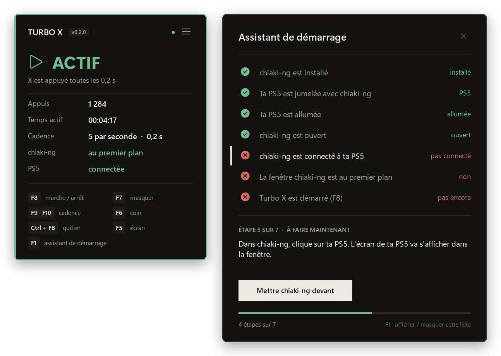
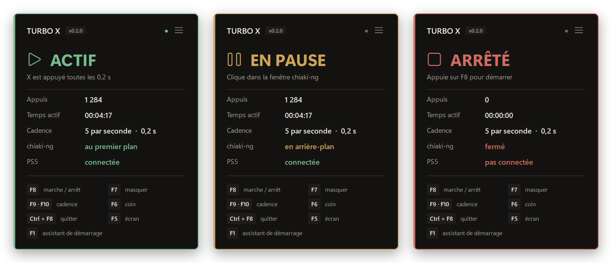
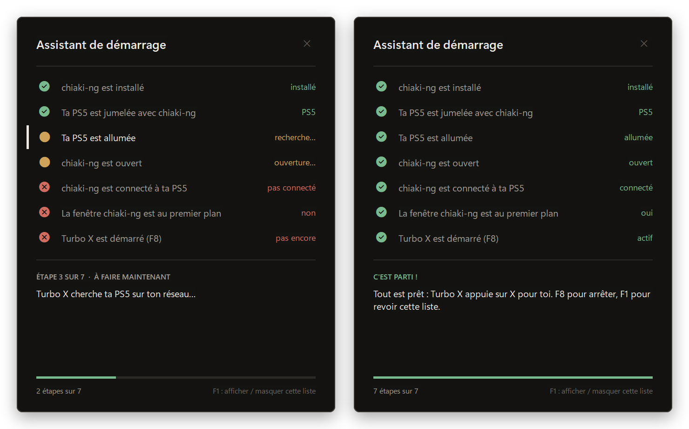
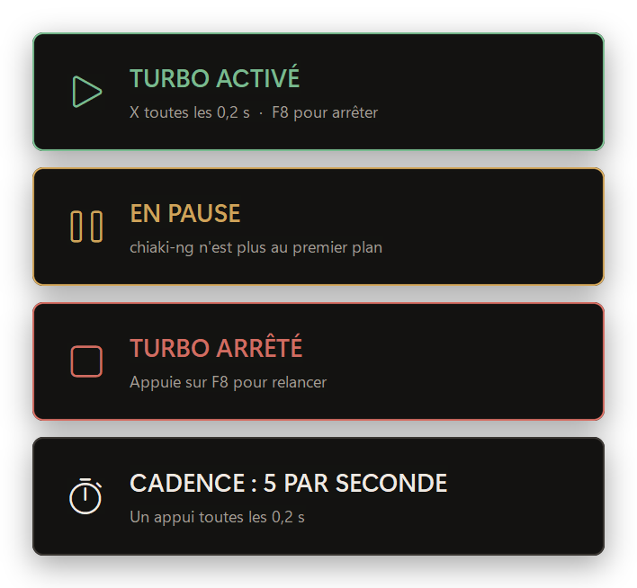

# Turbo X

**Le bouton turbo de la touche ✕ pour ta PS5.** Turbo X appuie sur ✕ en boucle à ta place, à travers [chiaki-ng](https://github.com/streetpea/chiaki-ng), le logiciel libre et gratuit de Lecture à distance.

[](https://github.com/LASCAMPIA67/turbo-x/actions/workflows/verification.yml)
[](https://github.com/LASCAMPIA67/turbo-x/releases/latest)
[](LICENSE)




## Sommaire

- [Ce que fait Turbo X](#ce-que-fait-turbo-x)
- [Ce qu'il te faut](#ce-quil-te-faut)
- [Installation](#installation)
- [La première fois : jumeler ta PS5](#la-première-fois--jumeler-ta-ps5)
- [Utilisation](#utilisation)
- [Raccourcis clavier](#raccourcis-clavier)
- [Réglages](#réglages)
- [Sécurité](#sécurité)
- [Dépannage](#dépannage)
- [Questions fréquentes](#questions-fréquentes)
- [Contribuer](#contribuer)
- [Licence et avertissement](#licence-et-avertissement)

## Ce que fait Turbo X

- **Il appuie sur ✕ pour toi**, de 1 à 10 fois par seconde (✕ correspond à la touche Entrée dans chiaki-ng).
- **Sécurité d'abord :** il n'appuie que si la fenêtre chiaki-ng est au premier plan **et** connectée à ta PS5. Sinon, il se met en pause tout seul et te dit pourquoi.
- **Un assistant de démarrage** : une liste qui se coche toute seule (chiaki-ng installé, PS5 jumelée, allumée, connectée…), avec la marche à suivre pour chaque étape.
- **Tout est automatique** : au lancement, Turbo X trouve ta PS5 sur ton réseau, ouvre chiaki-ng et le connecte directement si la console est allumée.
- **Un panneau toujours visible** sur l'écran du jeu, même avec deux écrans, qui ne prend jamais le clavier à chiaki-ng.
- **Il se souvient de tes choix** : cadence, coin et écran du panneau, sons.



## Ce qu'il te faut

- Un PC sous **Windows 10 ou 11**.
- Une **PS5** reliée à la même box Internet que le PC, en Wi-Fi ou par câble.
- **chiaki-ng**, gratuit : [télécharger chiaki-ng](https://github.com/streetpea/chiaki-ng/releases/latest).
- Rien d'autre : `TurboX.exe` marche sans rien installer de plus.

## Installation

1. Ouvre la [dernière version publiée](https://github.com/LASCAMPIA67/turbo-x/releases/latest) et télécharge `TurboX-x.y.z.zip`.
2. Décompresse-le où tu veux, par exemple dans `Documents\Turbo X`.
3. Double-clique sur `TurboX.exe`.

> [!NOTE]
> Windows peut afficher « Windows a protégé votre ordinateur », parce que Turbo X n'est pas signé (un certificat de signature est payant). Clique sur **Informations complémentaires**, puis sur **Exécuter quand même**. Tu peux vérifier que le fichier vient bien de ce dépôt : voir [Vérifier un téléchargement](#vérifier-un-téléchargement).

**Depuis le code source :** installe [AutoHotkey v2](https://www.autohotkey.com/), télécharge ce dépôt, puis double-clique sur `src/TurboX.ahk`.

## La première fois : jumeler ta PS5

C'est à faire une seule fois :

1. Sur la PS5 : **Paramètres › Système › Lecture à distance**, puis active **Activer la Lecture à distance**.
2. Au même endroit, choisis **Associer un appareil** : un code à 8 chiffres s'affiche.
3. Dans chiaki-ng, clique sur ta PS5 (elle apparaît toute seule), puis suis les indications : chiaki-ng te demande ton identifiant PlayStation Network (il peut le retrouver tout seul si tu te connectes), puis le code.

Pour pouvoir réveiller ta PS5 depuis le mode repos : **Paramètres › Système › Économie d'énergie › Fonctions disponibles en mode repos**, puis active **Rester connecté à Internet** et **Activer l'allumage de la PS5 depuis le réseau**.

## Utilisation

1. Lance `TurboX.exe` : l'**assistant de démarrage** s'ouvre sur l'écran du jeu, et Turbo X ouvre chiaki-ng pour toi.
2. Suis la ligne marquée d'un trait clair. Chaque étape se coche toute seule : vert = validée, ambre = en cours, rouge = pas encore.
3. Dans le jeu, place-toi là où il faut appuyer sur ✕, puis appuie sur <kbd>F8</kbd>.
4. Pour arrêter, appuie à nouveau sur <kbd>F8</kbd>. Pour quitter : <kbd>Ctrl</kbd> + <kbd>F8</kbd>.



Le panneau affiche l'état en grand : **ACTIF** (vert), **EN PAUSE** (ambre) ou **ARRÊTÉ** (rouge). Une notification apparaît en haut de l'écran à chaque changement.



## Raccourcis clavier

| Touche | Action |
| --- | --- |
| <kbd>F8</kbd> | démarrer / arrêter |
| <kbd>F9</kbd> / <kbd>F10</kbd> | plus lent / plus rapide |
| <kbd>F7</kbd> | afficher / masquer le panneau |
| <kbd>F6</kbd> | changer le panneau de coin |
| <kbd>F5</kbd> | changer le panneau d'écran : écran du jeu, de gauche, de droite… |
| <kbd>F1</kbd> | afficher / masquer l'assistant de démarrage |
| <kbd>Ctrl</kbd> + <kbd>F8</kbd> | quitter |

Toutes ces actions sont aussi dans le **menu** : bouton ☰ du panneau, clic droit sur le panneau, ou icône près de l'horloge.

## Réglages

La plupart des réglages se font avec les touches ci-dessus, et Turbo X s'en souvient. Pour aller plus loin avec le code source, ils sont tous en haut de `src/TurboX.ahk` :

| Réglage | Par défaut | Rôle |
| --- | --- | --- |
| `TOUCHE` | `Enter` | touche du clavier qui fait ✕ dans chiaki-ng |
| `CADENCE_MS` | `200` | un appui toutes les 200 ms |
| `CADENCE_MIN`, `CADENCE_MAX` | `100`, `1000` | limites de <kbd>F9</kbd> et <kbd>F10</kbd> |
| `PAS_MS` | `50` | ce que change chaque appui sur <kbd>F9</kbd> ou <kbd>F10</kbd> |
| `APPUI_MS` | `60` | durée de chaque appui |
| `CIBLE` | `chiaki` | nom du programme dans lequel appuyer |
| `VERIF_PS5` | `true` | n'appuyer que si chiaki-ng est connecté à la PS5 (`false` si tu joues par Internet) |
| `SONS` | `true` | petits bips au démarrage et à l'arrêt |
| `COIN` | `1` | coin du panneau : 1 haut-gauche, 2 haut-droite, 3 bas-droite, 4 bas-gauche |
| `ECRAN` | `0` | écran du panneau : 0 = celui du jeu, 1 = le plus à gauche, 2 = le suivant… |
| `OUVRIR_CHIAKI` | `true` | ouvrir chiaki-ng au lancement |
| `CONNEXION_AUTO` | `true` | connecter chiaki-ng tout seul si la PS5 est allumée |

Ce que Turbo X retient (cadence, coin, écran, sons) est rangé dans `%APPDATA%\Turbo X\memoire.ini`. Pour tout remettre comme au départ : menu ☰ › **Remettre les réglages d'origine**.

## Sécurité

- Turbo X n'envoie **rien** si la fenêtre au premier plan n'est pas chiaki-ng, ou si chiaki-ng n'est pas connecté à ta PS5. Il ne peut donc pas appuyer par erreur dans une autre fenêtre, ni dans les menus de chiaki-ng.
- La touche est toujours relâchée quand Turbo X se ferme.
- Ses fenêtres (panneau, notifications, assistant) ne prennent jamais le clavier à chiaki-ng.
- Une seule copie de Turbo X tourne à la fois.
- Aucune donnée n'est envoyée sur Internet. Le détail est dans [SECURITY.md](SECURITY.md).

### Vérifier un téléchargement

Chaque version publiée est fabriquée par GitHub à partir du code de ce dépôt, avec une **attestation de provenance**. Pour la vérifier avec [GitHub CLI](https://cli.github.com/) :

```shell
gh attestation verify TurboX.exe --repo LASCAMPIA67/turbo-x
```

Le fichier `SHA256SUMS.txt` de chaque version donne aussi l'empreinte de chaque fichier.

## Dépannage

**Le panneau reste « EN PAUSE ».** Lis la phrase sous « EN PAUSE » : elle dit quoi faire. Le plus souvent, il suffit de cliquer dans la fenêtre chiaki-ng.

**C'est « ACTIF », mais rien ne se passe dans le jeu.** Dans chiaki-ng, ouvre les réglages, onglet **Keys**, et vérifie que ✕ (*Cross*) correspond à la touche Entrée (*Return*). Sinon, change `TOUCHE` en haut du script.

**L'assistant dit « introuvable » pour la PS5.** Vérifie qu'elle est allumée (ou en mode repos) et reliée à la même box que le PC. Si le pare-feu de Windows demande l'autorisation pour Turbo X, accepte. Un VPN peut gêner la recherche : Turbo X essaie quand même chaque connexion du PC.

**chiaki-ng ne se connecte pas tout seul.** Clique sur ta PS5 dans chiaki-ng. Pour que Turbo X ne tente plus de connexion directe, mets `CONNEXION_AUTO := false`.

**Je joue à distance, par Internet.** Mets `VERIF_PS5 := false` : dans ce cas, Turbo X ne peut pas vérifier la connexion à la PS5.

**Windows ou l'antivirus bloque `TurboX.exe`.** Voir la note de la partie [Installation](#installation). Les programmes AutoHotkey transformés en `.exe` sont parfois signalés à tort ; le code est ouvert, et chaque fichier publié est attesté.

**Je ne trouve pas l'icône près de l'horloge.** Windows 11 la cache : clique sur la petite flèche **^** à gauche de l'horloge. Le plus simple reste le bouton ☰ ou le clic droit sur le panneau.

## Questions fréquentes

**Ça marche avec n'importe quel jeu ?** Oui : Turbo X appuie sur ✕, quel que soit le jeu. Place-toi simplement là où il faut appuyer.

**Est-ce autorisé ?** Turbo X simule des appuis sur une touche, comme une manette « turbo ». Certains jeux en ligne interdisent l'automatisation : respecte les règles de ton jeu. Tu l'utilises sous ta responsabilité.

**Et la PS4 ?** Turbo X est pensé pour la PS5. chiaki-ng gère aussi la PS4, mais la recherche automatique de Turbo X ne trouve que les PS5.

**Turbo X lit-il mes identifiants ?** Non. Dans les réglages de chiaki-ng, il lit seulement le nom de tes consoles jumelées, jamais les clés d'association ni ton compte.

## Contribuer

Les idées et les corrections sont les bienvenues ! Lis le [guide de contribution](CONTRIBUTING.md) et le [code de conduite](CODE_OF_CONDUCT.md). Pour une question, passe par les [discussions](https://github.com/LASCAMPIA67/turbo-x/discussions). Les changements de chaque version sont dans le [journal des modifications](CHANGELOG.md).

## Licence et avertissement

Turbo X est distribué sous [licence MIT](LICENSE).

Turbo X n'est affilié ni à Sony Interactive Entertainment, ni au projet chiaki-ng. « PlayStation », « PS5 » et « PS4 » sont des marques de Sony Interactive Entertainment.
